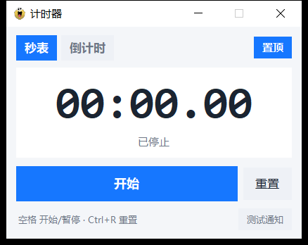

# 计时器（WinTimer）

一个 Windows 桌面小工具：**秒表 + 倒计时**，到点用系统通知提醒你。纯 Python（tkinter），无第三方运行时依赖。



## 功能

- **秒表**：点「开始」正计时 → 再点「暂停」→ 第三下「继续」；「重置」归零
- **倒计时**：`时 / 分 / 秒` 自己设（时 0–99，分/秒 0–59），或点预设：5 分 / 10 分 / 25 分 / 30 分 / 1 小时 / 2 小时
- **到点提醒**：Windows 系统通知（通知来源显示为「计时器」）+ 任务栏闪烁；通知发不出去时自动退回置顶提醒窗 + 提示音，不会漏掉
- **小窗置顶**：可随时开关，窗口高度随模式自适应
- 自动记住上次的模式、时长、窗口位置
- 快捷键：`空格` 开始/暂停、`Ctrl+R` 重置

## 直接使用

到 [Releases](../../releases) 下载：

- `计时器.exe` —— 绿色单文件，双击即用，不需要安装
- `计时器安装程序.exe` —— 安装版，带桌面/开始菜单快捷方式，可在「设置 → 应用」里卸载

> 首次运行会在开始菜单写一个「计时器」快捷方式：Windows 的系统通知要求桌面程序有一个带 AppUserModelID 的快捷方式，否则通知发不出去（这种情况下程序会自动改用弹窗提醒）。

## 从源码运行

```powershell
python main.py
```

只依赖标准库（tkinter），Python 3.10+ 均可。

## 打包

```powershell
pip install pyinstaller
powershell -ExecutionPolicy Bypass -File build\build.ps1 -Installer
```

产物在 `dist\`：`计时器.exe`（绿色版）和 `计时器安装程序.exe`（安装包）。
脚本会先跑一遍逻辑自检（`tools\selftest.py`，36 项），不通过就不出包。

## 换图标

替换 `assets/icon_source.jpg`，然后：

```powershell
python tools\make_icon.py
```

脚本会自动抠掉白底、保护眼球、裁边，输出 16–256px 全套 `icon.ico`。
（白底和眼白同色时直接泛洪会把眼白抠穿，所以脚本先按瞳孔定位并保护眼球区域再抠图。）

## 目录结构

| 路径 | 作用 |
| --- | --- |
| `main.py` | 程序入口 |
| `wintimer/app.py` | 界面与计时逻辑（秒表 / 倒计时） |
| `wintimer/theme.py` | 浅色主题配色、按钮与标签控件 |
| `wintimer/notify.py` | 系统通知（Toast）、快捷方式与 AppUserModelID |
| `wintimer/settings.py` | 配置读写（`%APPDATA%\WinTimer\settings.json`） |
| `installer/setup_app.py` | 安装 / 卸载向导 |
| `build/WinTimer.spec` | 主程序打包配置 |
| `build/Setup.spec` | 安装包打包配置 |
| `build/build.ps1` | 一键打包脚本 |
| `tools/selftest.py` | 计时逻辑自检（36 项） |
| `tools/make_icon.py` | 从原图生成图标 |
| `tools/uitest.py` | 自动驱动界面各状态并截图 |

## 已知说明

- 系统通知依赖「开始菜单快捷方式 + AppUserModelID」，通知失败时会自动退回弹窗提醒。
- 直接跑源码（`python main.py`）时通知来源会显示成 Windows PowerShell，因为开发模式不会注册带 AUMID 的快捷方式；打包后显示为「计时器」。
